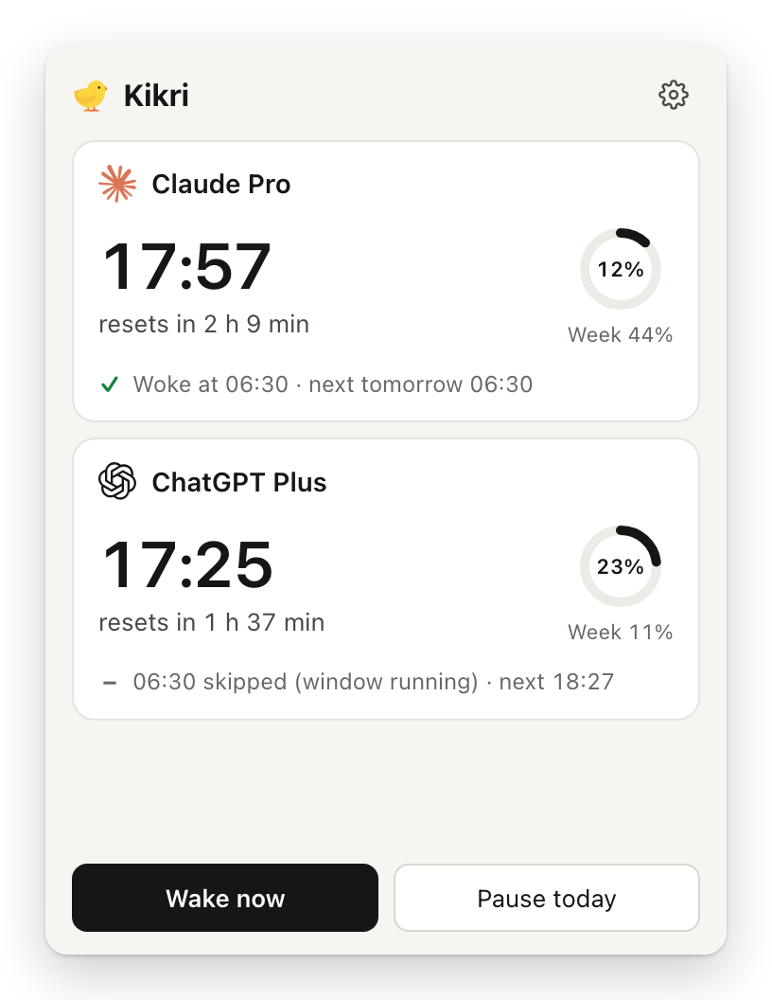

# Kikri

**English** | [中文](README.zh-CN.md)

> Kikri is short for *kikiriki*, the rooster's crow in Spanish.

A free, open-source menu bar / system tray app. On a schedule you choose, it sends a tiny request to your AI coding tools (Claude Code, Codex CLI) so their **5-hour usage window starts early**, and the next window refreshes sooner.

- Runs only the official CLIs you are already signed in to. It never reads, copies or uploads credentials
- Isolated and cheap: about 633 tokens per wake for Claude, about 5.2k for Codex
- Makes up wakes missed while the computer slept or was offline; skips a wake when official usage data shows a window is already running
- Shows when each window resets and how much of it you have used
- macOS and Windows, English and Chinese. Built with Go and Wails v3

> Kikri sends real requests through your own Claude / ChatGPT subscription. Make sure scheduled requests fit your plan's terms before you use it.

<p align="center">
  <picture>
    <source media="(prefers-color-scheme: dark)" srcset=".github/images/status-en-dark.png">
    
  </picture>
</p>

> Status: v0.1, an early release. Used daily on macOS; the Windows build compiles but has not been tested on a real machine yet.

## How it works

Claude and ChatGPT plans meter usage in 5-hour windows that start with your first request. If you start work at 09:00, your first window runs until 14:00. If Kikri wakes the plan at 06:30, the window resets at 11:30 instead, and your next full window starts in the middle of your working day.

Each wake runs the CLI in an empty folder (so no project files are sent), asks for a one-word reply without saving a session, and logs the result.

## Install

Install and sign in to [Claude Code](https://code.claude.com) or [Codex CLI](https://github.com/openai/codex) (at least one). Kikri only runs them; it needs no API keys.

### macOS (13 or later, Apple silicon and Intel)

1. Download `Kikri-<version>-macos.zip` from [Releases](../../releases), unzip it and drag **Kikri.app** into Applications.
2. The first time you open it, macOS says it can't verify the developer: Kikri has no paid Apple Developer ID (it is signed ad hoc).
   - Click **Done**, open **System Settings → Privacy & Security**, scroll to the bottom and click **Open Anyway** next to Kikri.
   - Or run in Terminal: `xattr -dr com.apple.quarantine /Applications/Kikri.app`
3. Kikri lives in the menu bar (a small chick) and has no Dock icon. Click it and follow the setup to pick your wake times.

### Windows (10 / 11)

1. Download `Kikri-<version>-windows-amd64.zip` from [Releases](../../releases) and unzip it to a permanent folder, such as `%LocalAppData%\Programs\Kikri`.
2. Double-click `kikri.exe`. When SmartScreen says "Windows protected your PC", click **More info → Run anyway** (the app has no code-signing certificate).
3. Kikri sits in the system tray at the bottom right. Its window uses the built-in WebView2 (included in Windows 11; on Windows 10 it comes with a current Edge).

### Verify the download

Each release includes `SHA256SUMS.txt`:

```bash
shasum -a 256 -c SHA256SUMS.txt --ignore-missing   # macOS
```

```powershell
Get-FileHash .\Kikri-<version>-windows-amd64.zip -Algorithm SHA256   # Windows: compare with SHA256SUMS.txt
```

## Claude Code status line

Claude has no read-only usage query. The only official source of the reset time is the data Claude Code passes to its status line. By default Kikri puts a small relay in front of your status line command in `~/.claude/settings.json`:

- It saves only the rate limits (5-hour and weekly usage and reset times), then runs your original command with the same input, so your status line looks the same.
- If you had no status line, Kikri shows a short one: `5h 23% · resets 18:30 · week 54%`.
- Your original setting is backed up. Turning the option off in Settings restores it.

You can untick it during setup or turn it off later. Without it, Kikri estimates the reset time from when you last used Claude Code.

## Uninstall

1. Open Kikri → Settings. **First turn off "Read Claude Code's status line"** (this restores your original status line in `~/.claude/settings.json`), then turn off "Start at login". If you delete the app without doing this, on macOS the status line command falls back to your original one automatically, but Kikri's part stays in settings.json.
2. Quit Kikri and delete Kikri.app (on Windows, delete the unzipped folder).
3. Delete the data folder: `~/Library/Application Support/Kikri` on macOS, `%AppData%\Kikri` on Windows.

## Development

Requires Go 1.27+ and Node.js (only to build the TypeScript frontend).

```bash
make run        # build and start the tray app
make app        # build bin/Kikri.app (macOS, signed ad hoc)
make windows    # cross-compile bin/kikri.exe
make dist       # release archives: universal Kikri.app, Windows exe, SHA256SUMS (in bin/dist)
make test vet   # Go tests, go vet, TypeScript type check
make diagnose   # print environment detection as JSON, without the UI

./bin/kikri -wake claude -dry-run   # print the wake command without sending it
./bin/kikri -wake codex             # send one real wake and print the result (starts that plan's 5-hour window)
./bin/kikri -plan claude=early-bird # set a schedule: early-bird / three / 06:30,11:35 / off (weekdays by default)
./bin/kikri -status                 # print schedules, next wakes, usage and the recent log
```

- `KIKRI_HOME=<dir>`: use another data folder (default `~/Library/Application Support/Kikri` on macOS, `%AppData%\Kikri` on Windows)
- `KIKRI_DEBUG=1`: turn on Wails debug logging

Layout:

```
main.go              entry point (-diagnose / -wake / -plan / -status / -version)
internal/app         Wails app: tray, popup window, the Service the frontend calls, notifications
internal/detect      finding the CLIs (login shell → process PATH → common paths), versions, sign-in state
internal/appdir      data folder and the empty sandbox directory
internal/wake        wake runner: isolated command, output parsing, error classes, network probe, file lock
internal/schedule    schedules: presets, weekdays, times, make-up deadline (pure functions)
internal/scheduler   engine: checks every 30 s, make-up, retries, Smart Skip, pause today, log
internal/store       SQLite: settings, per-slot state, wake log
internal/quota       read-only Codex usage query (app-server)
internal/activity    session file modification times (mtime only, never contents)
internal/statusline  Claude's reset time from Claude Code's status line (on by default; turning it off restores yours)
internal/locale      UI language: the system's, or the user's choice
internal/proc        child processes: stdin from the null device, hard timeouts, killing the whole process group
internal/autostart   start at login (macOS LaunchAgent / Windows registry Run key)
internal/gui/assets  static frontend files (app.js is built from frontend/)
frontend/src         popup: status, log, settings, first-run setup (TypeScript, no framework); text in i18n.ts
frontend/            TypeScript sources (bundled with esbuild, type-checked with tsc)
build/darwin         Info.plist (LSUIElement: menu bar only)
.github/workflows    on a v* tag: test, build both platforms and publish a release
```

## License

[MIT](LICENSE)

The icon is Microsoft's [Fluent UI Emoji](https://github.com/microsoft/fluentui-emoji) "Baby chick" (MIT, Copyright (c) Microsoft Corporation), mirrored; see [build/icons](build/icons/README.md).

The Claude and OpenAI logos in the popup come from [lobe-icons](https://github.com/lobehub/lobe-icons) (MIT, Copyright (c) 2023 LobeHub), see `frontend/src/logos.ts`. They are trademarks of Anthropic and OpenAI; Kikri uses them only to show which service a card belongs to and is not affiliated with either company.
